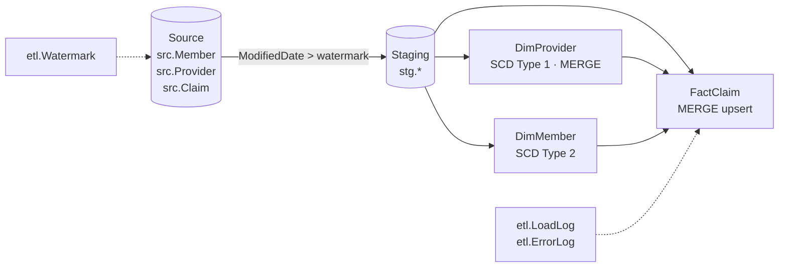
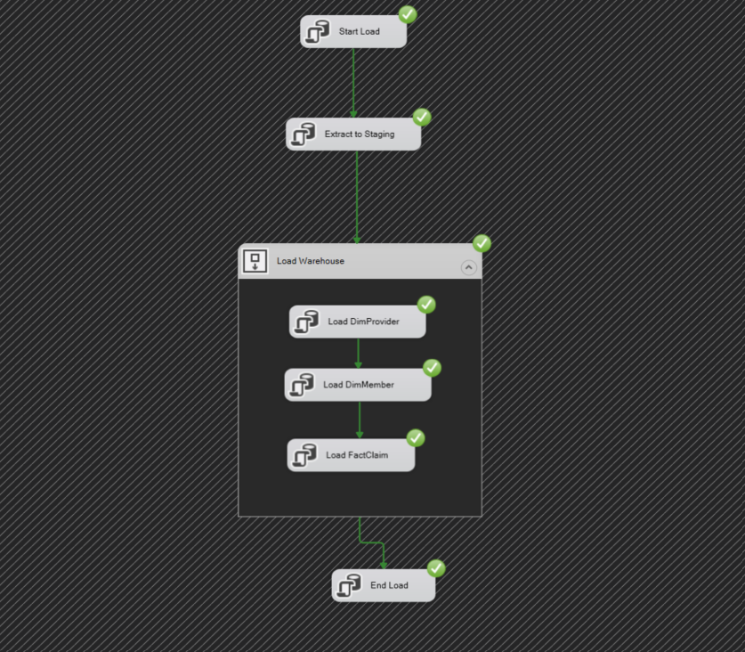
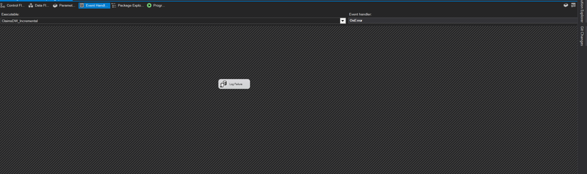
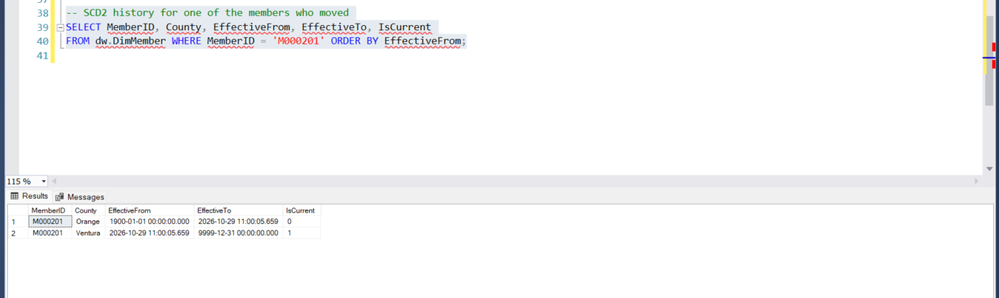
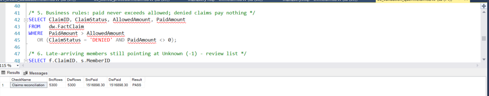

# Incremental ETL Framework — SQL Server + SSIS

A production-style incremental load framework for a healthcare claims data warehouse, built in T-SQL and orchestrated by SSIS.

It covers the patterns found in most real ETL jobs: **watermark-based incremental extract, SCD Type 1 and Type 2 dimensions, MERGE upserts, late-arriving dimensions, audit logging, error handling and reconciliation.**

All data is synthetic. No real PHI is used.

---

## Architecture



| Schema | Purpose |
| --- | --- |
| `src` | Simulated source claims system (in real life, a different server) |
| `stg` | Staging, truncated on every run |
| `dw` | Star schema: `DimMember`, `DimProvider`, `FactClaim` |
| `etl` | Watermarks, audit log, error log, all procedures |

---

## What it demonstrates

| Pattern | Where | How |
| --- | --- | --- |
| **Incremental extract** | `etl.usp_ExtractToStaging` | Pulls rows where `ModifiedDate` falls in the window (last watermark, max at start]. The fixed upper bound means rows written mid-load aren't lost. |
| **Safe watermarks** | `etl.Watermark` | The new watermark is staged as `PendingLoadedDate` and promoted only after a successful commit. A failed run is simply re-extracted. |
| **SCD Type 2** | `etl.usp_LoadDimMember` | SHA-256 row hash detects change, expires the old row (`EffectiveTo`, `IsCurrent = 0`) and inserts a new version. A filtered unique index guarantees one current row. |
| **SCD Type 1** | `etl.usp_LoadDimProvider` | `MERGE` with a hash comparison, so unchanged rows are never rewritten |
| **Point-in-time lookup** | `etl.usp_LoadFactClaim` | Each claim joins to the member version valid on its **service date** |
| **Late-arriving dimension** | `etl.usp_LoadFactClaim` | A claim for an unknown member loads with `MemberKey = -1` instead of failing |
| **Upsert** | `etl.usp_LoadFactClaim` | `MERGE` inserts new claims and updates only those that actually changed, such as PENDING → PAID |
| **Audit** | `etl.LoadLog` | One row per run: start/end, status, rows extracted/inserted/updated |
| **Error handling** | `etl.usp_RunClaimsPipeline` | `TRY/CATCH` + `XACT_ABORT`, full rollback, error detail in `etl.ErrorLog`, then `THROW` so SQL Agent/SSIS marks failure |
| **Reconciliation** | `05_validation_queries.sql` | Source vs warehouse row and amount checks, SCD2 gap/overlap checks, business rules |

---

## Repository layout

```
sqlserver-incremental-etl/
├── sql/
│   ├── 01_create_database_and_source.sql   database, schemas, source tables, sample data
│   ├── 02_etl_framework_and_tables.sql     watermark, audit, staging, dimensions, fact
│   ├── 03_stored_procedures.sql            all ETL procedures + master pipeline
│   ├── 04_run_and_simulate_changes.sql     full load → source changes → incremental load
│   └── 05_validation_queries.sql           reconciliation and data quality checks
└── ssis/
    └── SSIS_PACKAGE_GUIDE.md               build the SSIS package step by step
```

---

## How to run

**Requirements:** SQL Server 2017+ (Developer Edition is free) and SSMS.

1. Run `01` → `02` → `03` in SSMS, in order.
2. Run `04` block by block:
    - **Run 1** (full load): 5,540 rows extracted, 5,000 claims, 500 members, 40 providers
    - **Source changes:** 25 plan changes, 10 terminations, pending claims adjudicated, 1 provider leaves the network, 200 new claims
    - **Run 2** (incremental): only the changed rows load. Member versions are created, claims update rather than duplicate.
    - **Run 3:** nothing changed, so 0 rows load
3. Run `05`. Every check should return 0 rows or `PASS`.
4. 4. **Run it through SSIS:** open `ssis/ClaimsDW_ETL/ClaimsDW_ETL.sln` in Visual Studio (SSIS extension required), then:
    - Reset with scripts `01` → `03`
    - Run the package: full load (5,540 rows)
    - Run `06_simulate_source_changes.sql` **once**
    - Run the package again: incremental load picks up only the 400 changed rows (15 members, 85 claim corrections, 300 new claims)

    The *Results* section above shows this run. To rebuild the package from scratch, follow `ssis/SSIS_PACKAGE_GUIDE.md`.

---

## Design notes

- **Why hash instead of comparing columns?** One `VARBINARY(32)` comparison replaces N nullable column comparisons, and it's easy to extend. `ISNULL(..., '~')` stops NULLs from colliding with real values.
- **Why do the first member versions start at 1900-01-01?** Claims with service dates before the first load still find a matching member version.
- **Re-pointing late-arriving claims:** this framework flags them (validation query 6). A production version would add a step that re-keys `-1` claims once the member arrives.
- **Scaling up:** for very large fact tables, swap `MERGE` for staged `UPDATE` + `INSERT` batches and add partitioning on `ServiceDateKey`.

---

## Results

Three SSIS runs: a full load, a run with no source changes (nothing loaded), then an incremental load that picked up only the 400 changed rows.










---

## Tech stack

SQL Server · T-SQL · SSIS · SQL Server Agent · SSISDB
